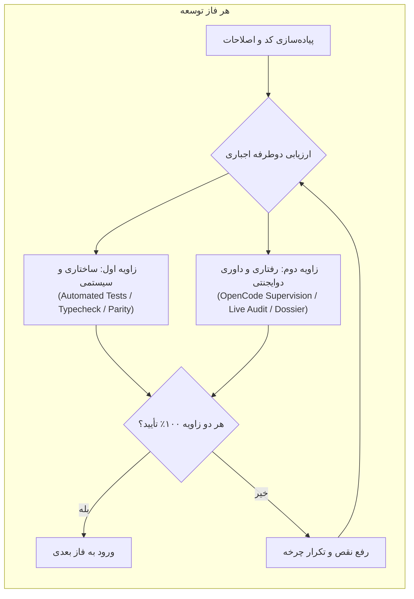
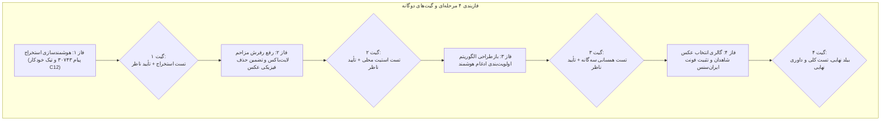

# قرارداد جامع فاز توسعه: هوشمندسازی استخراج، بهینه‌سازی فرم‌ها، ادغام پیشرفته و ارزیابی دوگانه
## Comprehensive Reporting Workflow, Intelligence & Form Optimization Contract
### تاریخ تنظیم: ۲۰۲۶-۱۰-۲۴ | کد قرارداد: `CONTRACT-20261024-REPORTING-PERFECTION`
### مرجع استاندارد: استانداردهای معماری `AGENTS.md` و پروتکل داوری دوایجنتی `OPENCODE_SUPERVISION_PROTOCOL.md`

---

## ۱. بیانیه هدف و دامنه قرارداد

این قرارداد چارچوب الزام‌آور مهندسی برای ارتقای قابلیت‌های هستهٔ گزارش‌گیری، رابط کاربری کارتابل فرهنگی، موتور استخراج هوشمند پیام‌های ایتا و بهینه‌سازی عملکرد فرم پرونده جامع رویداد است. تمامی فعالیت‌ها ذیل این سند باید به صورت دقیق فازبندی شده و طبق **قانون ارزیابی دوطرفه اجباری (Mandatory Dual-Perspective Law)** در هر فاز به تأیید ۱۰۰ درصدی برسند.

---

## ۲. قانون بنیادین: ارزیابی دوطرفه اجباری (Dual-Perspective Evaluation Law)

در هر یک از فازهای چهارگانهٔ این قرارداد، عامل مجری موظف است کارکرد پیاده‌سازی‌شده را بدون استثنا از **دو زاویهٔ مستقل و نامتقارن** مورد سنجش قرار داده و تنها پس از تحقق کامل شرایط هر دو جانب، مجاز به آغاز فاز بعد خواهد بود:

### مؤلفه‌های دو زاویه ارزیابی:
1. **زاویه اول — ارزیابی سیستمی، ساختاری و قراردادی (Contractual & Structural Automation):**
   - آزمون‌های خودکار واحد، سناریویی و رگرسیون با `pytest`.
   - تایپ‌چک بدون خطای تایپ‌اسکریپت (`npm.cmd --prefix ui run check`).
   - بیلد تولیدی کلاینت با Vite (`npm.cmd --prefix ui run build`).
   - تست‌های قرارداد ناظر (`npm.cmd --prefix ui run test:observability`).
   - راستی‌آزمایی تقارن بسته Wheel و یکپارچگی حافظه پروژه (`scripts/check_project_memory_integrity.py`).

2. **زاویه دوم — ارزیابی رفتاری بیرونی و داوری دوایجنتی (Runtime Behavioral & Two-Agent Supervision):**
   - راستی‌آزمایی رفتاری بلک‌باکس با نمونه‌های واقعی داده (مانند پیام #30743 ایتا).
   - اعتبارسنجی زنده در مرورگر (حذف پرش صفحه، تداوم وضعیت فرم بدون Unmount، استیت پایدار).
   - صدور پرونده نظارتی رسمی در `diagnostics/opencode_supervision_dossier.json`.
   - اجرای آزمون داوری دوایجنتی با رانر `scripts/run_opencode_supervision.py`.
   - احراز حکم رسمی `APPROVED` با کلیه شاخص‌های مثبت (`True`) در `diagnostics/opencode_supervision_verdict.json`.

---

## ۳. تحلیل تفصیلی محورهای شش‌گانه فنی

### محور ۱: تیک خودکار «قرائت زیارت عاشورا (C12)» با صدور شاخصه جزئی
* **وضعیت قبل:** فیلد `is_ashura_pilgrimage` یک سوییچ مجزا بود و با ورود شاخصه جزئی زیارت عاشورا تغییری نمی‌کرد و در ثبت ایتا به بک‌اند ارسال نمی‌شد.
* **الزام قرارداد:**
  1. در صورت وجود یا انتخاب شاخصه جزئی زیارت عاشورا در فرم، یا وجود عبارت «زیارت عاشورا» در متن پیام، فیلد `is_ashura_pilgrimage` به صورت خودکار فعال (`true`) شود.
  2. ارسال قطعی این فیلد در متد `POST /api/v3/reporting/events`.
  3. استنتاج خودکار در بک‌اند در صورت وجود کلیدواژه عاشورا در متن یا میکروها به عنوان سپر دفاعی (Derivation Fallback).

### محور ۲: رفع بارگزاری مجدد لایت‌باکس/فرم و راستی‌آزمایی حذف فیزیکی عکس
* **وضعیت قبل:** تابع `fetchEventData` دارای `setLoading(true)` بود که کل محتوای لایت‌باکس را با اسپینر لودینگ جایگزین و کلیه تب‌ها را Unmount می‌کرد.
* **الزام قرارداد:**
  1. پیاده‌سازی متد همگام‌سازی بی‌صدا: `fetchEventData(id, { silent: true })` بدون فعال‌سازی لودینگ سراسری.
  2. در هنگام حذف عکس (`handleDeleteDocument`)، به‌روزرسانی آنی و محلی استیت (`rawEvent.documents`) تا عکس بدون لرزش و بدون بازخوانی کل لایت‌باکس ناپدید شود.
  3. تضمین ادامهٔ فراخوانی ماژول حذف فیزیکی دیسک (`os.remove(storage_ref)`) در بک‌اند و پاک‌سازی فایل از پوشه رویداد.

### محور ۳: بازتنظیم اولویت‌های ادغام هوشمند (Smart Merge Ranking)
* **وضعیت قبل:** امتیازدهی مبتنی بر شاخصه‌های جزئی و سپس برنامه‌ها بدون اولویت‌بندی دقیق کاربر بود.
* **الزام قرارداد — اعمال ترتیب سه‌گانه دقیق کاربر:**
  1. **پله اول (شاخصه کلی):** تطابق `macro_indicator` با بالاترین وزن پایه (۵۰ امتیاز).
  2. **پله دوم (شاخصه‌های جزئی بر حسب میزان همسانی):** محاسبه ضریب تشابه اشتراک به کل (Jaccard Overlap Ratio) و اعطای امتیاز متناسب با نسبت تشابه (تا ۳۵ امتیاز).
  3. **پله سوم (همسانی واحد قضایی):** اولویت ویژه و تفکیک‌شده برای حوزه‌های قضایی شهرستان‌ها نسبت به ستاد استانی (۲۰ امتیاز).
  4. معیارهای تاریخی و متنی صرفاً به عنوان فاکتورهای کمکی در انتهای جدول قرار گیرند.

### محور ۴: امکان انتخاب و الصاق تصاویر از بین شاهدان ایتا در فرم ثبت گزارش
* **وضعیت قبل:** در پنل ثبت رویداد، شاهدان فقط متنی متصل می‌شدند و هیچ گالری انتخابی برای عکس‌ها وجود نداشت.
* **الزام قرارداد:**
  1. اضافه شدن گالری انتخاب تصاویر پیام‌های شاهد در استپ شاهدان و بازبینی با پیش‌نمایش بندانگشتی.
  2. وجود چک‌باکس انتخاب تصویر (پیش‌فرض انتخاب‌شده) و دکمه انتخاب به عنوان تصویر جلد پرونده.
  3. بارگذاری و الصاق خودکار تصاویر تیک‌خورده به عنوان `event_documents` رویداد به محض ثبت موفق در سرور.

### محور ۵: استخراج دقیق هوشمند رابط و حوزه قضایی (حل خطای پیام ۳۰۷۴۳)
* **وضعیت قبل:** ارسال پیام توسط اکانت "Arman" و وجود عبارت «دادگستری کل» در متن، باعث نادیده گرفتن نویسنده واقعی و انتساب اشتباه به ستاد استانی می‌شد؛ نام چهاردانگه نیز در لیست شهرها نبود.
* **الزام قرارداد:**
  1. تقدم استخراج الگوهای متنی رابط بر نام اکانت ایتا با الگوی:
     `([نام رابط])\s*[-–—]\s*حوزه قضایی\s*([^-–—\n]+)\s*[-–—]\s*([^\n]+)`
  2. حذف قطعی شرط خطرساز `combinedText.includes('دادگستری کل')`.
  3. تکمیل فرهنگ لغت مناطق قضایی مازندران با ثبت چهاردانگه، کیاسر، بندپی، سوادکوه شمالی و سایر بخش‌ها.

### محور ۶: تثبیت دائمی و سراسری فونت ایران‌سنس (IRANSans)
* **وضعیت قبل:** مسیرهای نسبی `./fonts/...` در `theme.ts` و عدم اعمال صریح روی ریشه `body` باعث سوئیچ تصادفی به فونت‌های جایگزین سیستم می‌شد.
* **الزام قرارداد:**
  1. اصلاح آدرس‌های فونت به آدرس قطعی `/fonts/...`.
  2. اعمال صریح و اولویت‌دار `fontFamily` روی تگ‌های `html, body, #root, *` در `MuiCssBaseline`.
  3. افزودن دستورالعمل Preload در `ui/index.html` و اطمینان از سلامت پکیج با `sync_ui_fonts.py`.

---

## ۴. ساختار اجرایی فازها و معیارهای دروازه ورود/خروج (Gate Criteria)

---

### فاز ۱: هوشمندسازی استخراج، رفع باگ پیام ۳۰۷۴۳ و اتوماسیون تیک زیارت عاشورا

* **اقدامات اجرایی:**
  1. اصلاح تابع `inferRegistrationDefaults` در `ui/src/ReportingRegistrationPanel.tsx`:
     - پیاده‌سازی رگولار اکسپرشن تشخیص سربرگ استاندارد رابطین دادگستری.
     - اولویت‌دهی به نام استخراج‌شده از متن بر نام کاربری یا نمایش ایتا ("Arman").
     - حذف شرط کور `combinedText.includes('دادگستری کل')`.
     - افزودن حوزه قضایی چهاردانگه و سایر بخش‌ها به دایره لغات معتبر.
  2. پیوند خودکار شاخصه جزئی زیارت عاشورا به فیلد `is_ashura_pilgrimage`:
     - در `ReportingRegistrationPanel.tsx`: فعال‌سازی خودکار و ارسال در پی‌لود اولیه.
     - در `ReportEventDetailModal.tsx`: فعال‌سازی خودکار سوییچ با انتخاب یا وجود شاخصه جزئی.
     - در `store.py`: استنتاج بک‌اند در صورت وجود کلیدواژه در یادداشت‌ها یا شاخصه‌ها.

* **ارزیابی دوطرفه فاز ۱:**
  * **زاویه اول (ساختاری):**
    - تست واحد پایتون برای اعتبارسنجی استخراج عنوان، رابط و حوزه در صورت ورود متن پیام #30743.
    - اجرای `pytest` برای ماژول استخراج و بررسی عدم رگرسیون.
    - تایپ‌چک کامل فرانت‌اند (`npm run check`).
  * **زاویه دوم (رفتاری و نظارتی):**
    - آزمون بلک‌باکس با ورودی دقیق پیام ۳۰۷۴۳ و تأیید استخراج «حمید سعیدی» و «حوزه قضایی چهاردانگه» به جای Arman و ستاد استانی.
    - تشکیل پرونده نظارتی و اخذ حکم `APPROVED` در پرونده داوری دوایجنتی فاز ۱.

---

### فاز ۲: بهینه‌سازی فرم پرونده رویداد (حذف رفرش لایت‌باکس و تضمین حذف فیزیکی)

* **اقدامات اجرایی:**
  1. در `ui/src/components/ReportEventDetailModal.tsx`:
     - افزودن فلگ `silent: true` به متد `fetchEventData` تا در زمان بروزرسانی‌های پس‌زمینه، اسپینر تمام‌صفحه لود نشود و فرم دستخوش بازنشانی نگردد.
     - در متد `handleDeleteDocument`: اعمال به‌روزرسانی محلی و آنی وضعیت (`State Update`) به جای رفرش سنگین کل دیالوگ.
     - در متد `handleSave`: حفظ موقعیت تب، حفظ اسکرول و بروزرسانی آرام ای‌تگ بدون لرزش بصری.
  2. در `src/eitaa_bridge/reporting/store.py`:
     - بررسی صحت اجرای دستور `os.remove` در متد `delete_document` و ثبت گزارش تشخیصی سلامت فایل دیسک.

* **ارزیابی دوطرفه فاز ۲:**
  * **زاویه اول (ساختاری):**
    - تست پایتون برای احراز حذف قطعی فایل فیزیکی از روی دیسک پس از فراخوانی API حذف سند.
    - تایپ‌چک و تست‌های آبزروابیلیتی کلاینت.
  * **زاویه دوم (رفتاری و نظارتی):**
    - راستی‌آزمایی رفتاری عدم رخ دادن فلاش لودینگ، عدم پرش اسکرول و ناپدید شدن روان عکس پس از حذف.
    - ثبت پرونده نظارتی و احراز حکم `APPROVED` از داور مستقل دوایجنتی.

---

### فاز ۳: پیاده‌سازی اولویت‌های سه‌گانه الگوریتم ادغام هوشمند

* **اقدامات اجرایی:**
  1. در `src/eitaa_bridge/reporting/store.py` متد `find_merge_candidates`:
     - بازنویسی موتور امتیازدهی با تقدم قطعی شاخصه کلی:
       - **پله ۱ (وزن ۵۰):** همسانی `macro_indicator`.
       - **پله ۲ (وزن ۳۵):** ضریب تشابه جاکارد برای `micro_indicators`.
       - **پله ۳ (وزن ۲۰):** همسانی حوزه قضایی شهرستانی.
     - ثبت دلایل همسانی به صورت شفاف و تفکیک‌شده در آبجکت خروجی کاندیدا.
  2. در `ui/src/components/ReportEventDetailModal.tsx` (تب ادغام):
     - نمایش نشانگرهای شفاف همسانی بر اساس رتبه‌بندی جدید به کاربر.

* **ارزیابی دوطرفه فاز ۳:**
  * **زاویه اول (ساختاری):**
    - تست‌های اختصاصی در `tests/test_reporting_store.py` یا آزمون‌های تطابق برای سنجش رتبه‌بندی کاندیداها با وزن‌های جدید.
    - پاس شدن ۱۰۰ درصدی آزمون‌های بک‌اند مرتبط با ادغام.
  * **زاویه دوم (رفتاری و نظارتی):**
    - اعتبارسنجی بلک‌باکس رفتار الگوریتم در مقایسه گزارش‌های تستی و اثبات اولویت شاخصه کلی بر شاخصه جزئی و واحد.
    - اخذ حکم `APPROVED` در ارزیابی دوایجنتی فاز ۳.

---

### فاز ۴: گالری انتخاب تصاویر از شاهدان ایتا و تثبیت فونت ایران‌سنس

* **اقدامات اجرایی:**
  1. در `ui/src/ReportingRegistrationPanel.tsx`:
     - طراحی بخش گالری تصاویر استخراج‌شده از پیام‌های شاهد در استپ شاهدان و استپ بازبینی.
     - اضافه شدن چک‌باکس انتخاب تصویر و تعیین تصویر جلد اصلی.
     - الصاق خودکار تصاویر انتخابی در قالب `event_documents` پس از ساخت رویداد.
  2. در `ui/src/theme.ts` و `ui/index.html`:
     - اصلاح آدرس فونت به مسیر قطعی `/fonts/IRANSansWeb-Regular.woff2` و `/fonts/IRANSansWeb-Bold.woff2`.
     - اعمال اجباری `fontFamily` روی بدنه، ریشه و عناصر ورودی در `MuiCssBaseline`.
     - افزودن Preload در `ui/index.html`.
     - اجرای مجدد `scripts/sync_ui_fonts.py` و بیلد نهایی توزیع.

* **ارزیابی دوطرفه فاز ۴:**
  * **زاویه اول (ساختاری):**
    - بیلد کامل پروژه (`npm run build`) بدون اخطار یا شکست باندل.
    - اجرای آزمون تقارن بسته Wheel (`test_bundled_bridge_wheel_matches_current_source_tree`).
    - بررسی سلامت مستندات و حافظه مهندسی.
  * **زاویه دوم (رفتاری و نظارتی):**
    - راستی‌آزمایی بصری اعمال فونت ایران‌سنس در سرتاسر رابط کاربری بدون پرش به تاهوما.
    - راستی‌آزمایی فرایند انتخاب عکس شاهدان و الصاق خودکار به پوشه رویداد.
    - تشکیل پرونده نظارتی کلان و اخذ حکم نهایی `APPROVED` از داور مستقل دوایجنتی.

---

## ۵. تعهدات، تضمین‌ها و شرایط ابطال ناپذیر

1. **اصل تقدم پیاده‌سازی محلی (Local-First Precedence):** هیچ تغییر جدیدی نباید به قابلیت‌های محلی فعلی، سرعت پاسخ‌دهی یا ثبات پایگاه‌داده آسیب برساند.
2. **پایداری داده‌های عملیاتی:** اطلاعات حساس، فایل‌های دیتابیس در `data/`، نشست‌های فعال و لاگ‌ها محافظت‌شده و بدون دستکاری باقی می‌مانند.
3. **تکمیل چرخه:** هر فاز تنها در صورت کسب موفقیت ۱۰۰ درصدی در هر دو زاویه بسته شده و گزارش رسمی آن در دفتر پذیرش و یافته‌های حافظه مهندسی پروژه مستند خواهد شد.
