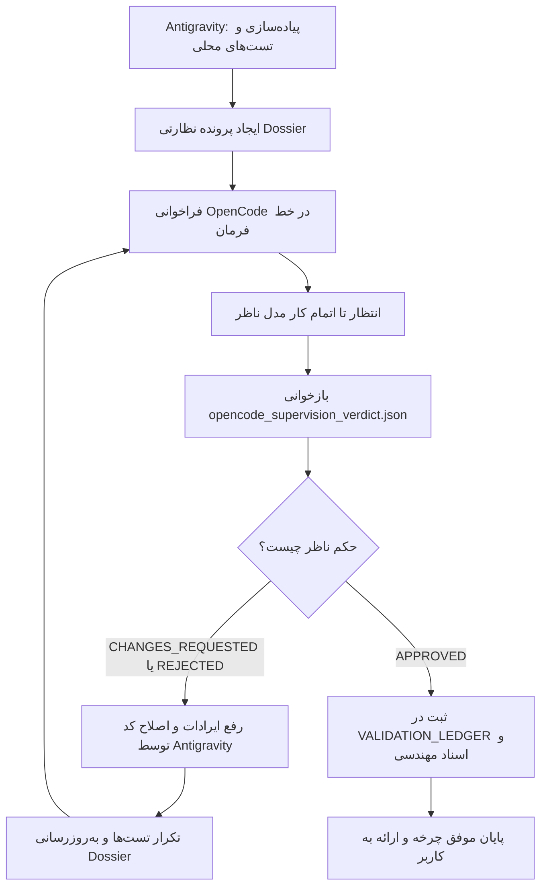

# قرارداد و پروتکل نظارت و داوری دوایجنتی با OpenCode (OSP)
## OpenCode Supervision & Audit Protocol

این سند استاندارد رسمی، دائمی و الزام‌آور برای نظارت، داوری مستقل، بازبینی کد و تأیید یا رد قابلیت‌های توسعه‌یافته در پروژه توسط مدل بیرونی از طریق دستور کامندی `opencode` است.

---

### ۱. هدف و فلسفه قرارداد

در توسعه سامانه‌های حیاتی، تکیه صرف بر خودارزیابی ایجنت توسعه‌دهنده (Antigravity) ممکن است به سوگیری شناختی (Confirmation Bias) یا نادیده‌گرفتن سناریوهای مرزی منجر شود. این پروتکل یک چرخه دوایجنتی ایجاد می‌کند:
1. **ایجنت مجری (Developer / Antigravity):** کدنویسی، رفع باگ، ایجاد جداول دیتابیس، نوشتن تست‌ها، ممیزی بصری زنده و آماده‌سازی پرونده نظارتی (Dossier).
2. **مدل ناظر مستقل (Supervisor / OpenCode Model):** بررسی عمیق و سخت‌گیرانه پرونده، راستی‌آزمایی تطابق با درخواست کاربر، تحلیل جامع کیفیت کد، امنیت، اسکیما و تست‌ها، و اعلام حکم نهایی در قالب ساختار داده معین.

---

### ۲. کانال ارتباطی و مسیر اجرایی

- **فرمان اجرایی در خط فرمان:**
  ```powershell
  # فراخوانی مستقیم از طریق CLI
  opencode run --auto --file diagnostics/opencode_supervision_dossier.json "<prompt>"
  ```
  یا اجرای خودکار و مدیریت چرخه توسط اسکریپت رانر پروژه:
  ```powershell
  python scripts/run_opencode_supervision.py
  ```
- **سرویس پس‌زمینه و API:**
  سامانه OpenCode از طریق سرویس محلی (`http://127.0.0.1:45278`) و اندپوینت‌های استاندارد v2 با مدل ناظر تبادل پیام می‌کند.

---

### ۳. قرارداد ورودی (Dossier Specification)

پیش از فراخوانی مدل ناظر، پرونده نظارتی جامع در مسیر زیر ایجاد و تثبیت می‌شود:
`diagnostics/opencode_supervision_dossier.json`

این فایل باید شامل بخش‌های زیر باشد:
1. `task_id`: شناسه تسک یا سناریوی جاری.
2. `user_requirements`: شرح دقیق نیازمندی‌ها و شروط اعلام‌شده از سوی کاربر.
3. `modified_files`: فهرست کامل فایل‌های ایجاد یا تغییر یافته به همراه مسیر قطعی.
4. `database_changes`: تغییرات اعمال‌شده در اسکیمای SQLite و داده‌های اولیه (Seed Data).
5. `test_results`: گزارش خروجی تست‌های واحد و رگرسیون بک‌اند و تایپ‌چک و ساخت فرانت‌اند.
6. `visual_audit_evidence`: فهرست و آدرس اسکرین‌شات‌های ممیزی بصری زنده (CDP).
7. `instructions_for_supervisor`: دستورالعمل صریح نظارت، معیارهای پذیرش و قالب خروجی مورد انتظار.

---

### ۴. قرارداد خروجی و اعلام حکم (Verdict Schema)

مدل ناظر موظف است پس از بررسی مستقل، ارزیابی و حکم قطعی خود را منحصراً در فایل زیر ذخیره نماید:
`diagnostics/opencode_supervision_verdict.json`

اسکیمای رسمی و اجباری فایل خروجی:

```json
{
  "$schema": "https://json-schema.org/draft/2020-12/schema",
  "title": "OpenCodeSupervisionVerdict",
  "type": "object",
  "required": [
    "status",
    "reviewed_at",
    "reviewer_model",
    "checklist",
    "findings",
    "summary"
  ],
  "properties": {
    "status": {
      "type": "string",
      "enum": ["APPROVED", "REJECTED", "CHANGES_REQUESTED"],
      "description": "حکم نهایی ناظر: تایید کامل، رد کامل، یا درخواست اعمال اصلاحات"
    },
    "reviewed_at": {
      "type": "string",
      "format": "date-time",
      "description": "زمان پایان بررسی به فرمت ISO 8601"
    },
    "reviewer_model": {
      "type": "string",
      "description": "نام و شناسه مدلی که داوری را انجام داده است"
    },
    "checklist": {
      "type": "object",
      "additionalProperties": { "type": "boolean" },
      "description": "چک‌لیست بررسی بندهای فنی خواسته کاربر (کلید: عنوان، مقدار: وضعیت رعایت)"
    },
    "findings": {
      "type": "array",
      "items": {
        "type": "object",
        "required": ["id", "severity", "scope", "description", "remedy"],
        "properties": {
          "id": { "type": "string" },
          "severity": {
            "type": "string",
            "enum": ["BLOCKER", "WARNING", "SUGGESTION"]
          },
          "scope": { "type": "string" },
          "description": { "type": "string" },
          "remedy": { "type": "string" }
        }
      },
      "description": "یافته‌ها، ایرادات فنی، یا نواقص شناسایی‌شده"
    },
    "summary": {
      "type": "string",
      "description": "تحلیل تشریحی و جمع‌بندی دلایل تایید یا رد"
    }
  }
}
```

---

### ۵. چرخه گردش کار و تکرار بازخورد (Feedback Loop)



قوانین حلقه بازخورد:
1. **عدم پذیرش احکام مبهم:** اگر فایل خروجی تولید نشود، ساختار JSON معتبر نباشد، یا فیلد `status` مشخص نباشد، وضعیت به عنوان ارزیابی ناتمام تلقی شده و کار تایید نمی‌شود.
2. **برطرف‌سازی یافته‌های انسدادی (BLOCKER):** در صورت وجود حتی یک مورد با شدت `BLOCKER`، وضعیت نمی‌تواند `APPROVED` باشد. Antigravity بلافاصله ایراد را رفع کرده و دور جدید نظارت را آغاز می‌کند.
3. **مستندسازی تاریخچه داوری:** سوابق احکام ناظر به همراه کد داوری در دفتر اعتبارسنجی ثبت می‌گردد.

---

### ۶. مدیریت ارائه‌دهنده‌ها و اعتبارسنجی در OpenCode

مدل‌های OpenCode می‌توانند از ارائه‌دهنده‌های مختلف تغذیه شوند:
- **حساب ابری OpenCode Console:** در صورت فعال بودن پلن کاربری.
- **کلیدهای اختصاصی کاربر:** نظیر Google Gemini، Groq، OpenAI، Anthropic یا DeepSeek که از طریق دستور `opencode auth login` یا متغیرهای محیطی استاندارد به سامانه معرفی می‌شوند.
- **مدل‌های محلی آفلاین:** از طریق Ollama یا سرور سازگار با OpenAI.
در صورت بروز خطای اعتبارنامه یا کسری موجودی حساب ابری در محیط، رانر پروژه علت دقیق خطا را به همراه راهنمای رفع موانع به کاربر گزارش می‌کند تا چرخه داوری مسدود نماند.
