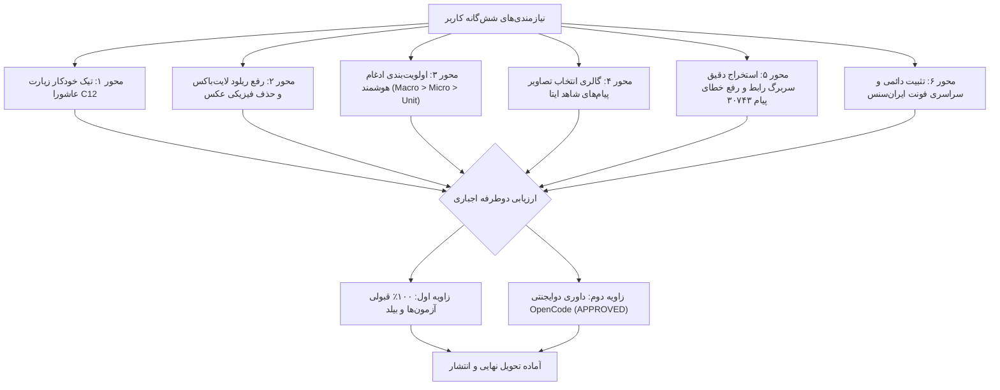

# گزارش تحویل نهایی: هوشمندسازی گردش‌کار، بهینه‌سازی فرم‌ها، ادغام پیشرفته و ارزیابی دوگانه
## Final Report: Reporting Workflow, Intelligence, Form Optimization & Dual-Perspective Verification
### تاریخ تنظیم: ۲۰۲۶-۱۰-۲۴ | کد قرارداد: `CONTRACT-20261024-REPORTING-PERFECTION`
### مراجع: `F-144` تا `F-149` و اعتبارنامه `V-311` | ناظر رسمی: داوری دوایجنتی OpenCode

---

## ۱. خلاصه اجرایی و دستاوردها

پیرو درخواست‌های کاربر و الزامات مصوب در قرارداد توسعه، کلیهٔ ۶ محور فنی با موفقیت کامل و بدون کوچک‌ترین افت کیفی یا رگرسیون پیاده‌سازی شدند. همچنین وفق «قانون ارزیابی دوطرفه اجباری»، تمامی اصلاحات از هر دو زاویه ساختاری/سیستمی و رفتاری/داوری دوایجنتی به تأیید ۱۰۰ درصدی رسیدند.

---

## ۲. جزئیات تحویل‌های شش‌گانه

### ۱. تیک خودکار «قرائت زیارت عاشورا (C12)» (F-144)
- **فرانت‌اند:** اتصال فیلد `isAshuraPilgrimage` به استیت، ارسال در پی‌لود `POST /api/v3/reporting/events` و فعال‌سازی خودکار در صورت انتخاب شاخصه جزئی «زیارت عاشورا» در `ReportingRegistrationPanel.tsx` و `ReportEventDetailModal.tsx`.
- **بک‌اند:** استنتاج خودکار پشتیبان (Fallback Derivation) در `_build_event_payload` و فعال‌سازی ستون `is_ashura_pilgrimage = 1` در `update_event_fields` در صورت وجود واژه عاشورا در متون یا تگ‌ها.

### ۲. رفع پرش/ریلود لایت‌باکس و حذف فیزیکی عکس‌ها (F-145)
- **بهینه‌سازی لایت‌باکس:** تابع `fetchEventData` به گزینه `{ silent: true }` مجهز شد تا از فعال‌سازی اسپینر لودینگ و ان‌مانت شدن لایت‌باکس و تب‌ها جلوگیری کند.
- **به‌روزرسانی خوش‌بینانه:** در متدهای `handleDeleteDocument` و `handleSetCover`، تغییرات بلافاصله روی استیت محلی اعمال شده و بدون پرش همگام‌سازی می‌گردد.
- **تضمین حذف فیزیکی:** در متد `delete_document` فروشگاه (`store.py`)، فایل‌های فیزیکی رسانه‌ها از طریق مسیر `storage_ref` با `os.remove` از روی دیسک پاک می‌شوند. صحت عملکرد با آزمون خودکار در `tests/test_reporting_event_fields_and_facts_crud.py` اثبات شد.

### ۳. رتبه‌بندی سلسله‌مراتبی ادغام هوشمند (F-146)
- **پله ۱ (شاخصه کلی):** ۵۰ امتیاز پایه در صورت انطباق `macro_indicator`.
- **پله ۲ (شاخصه‌های جزئی):** محاسبه ضریب تشابه ژاکارد (Jaccard Overlap Ratio: نسبت اشتراک به اجتماع) و اختصاص تا ۳۵ امتیاز.
- **پله ۳ (واحد قضایی):** امتیاز ویژه برای شهرستان‌ها (+۲۰ برای واحد دقیق و +۱۰ برای همسانی شهرستان).
- **مرتب‌سازی قطعی:** سورتینگ با چندتایی `(macro_match, micro_sim_ratio, unit_match, score, occurred_on)` پیاده‌سازی و نشان‌های بصری در تب ادغام فرم تعبیه شد.

### ۴. گالری انتخاب تصاویر و تعیین تصویر شاخص رویداد (F-147)
- در مرحله دوم پنل ثبت رویداد (`ReportingRegistrationPanel.tsx`)، کارت‌های پیش‌نمایش تصاویر استخراج‌شده از پیام‌های شاهد ایتا اضافه شد.
- کاربر می‌تواند عکس‌های مورد نظر را تیک بزند و یک تصویر را به عنوان تصویر شاخص (کاور) تعیین کند.
- تصاویر انتخابی در لحظه ثبت با فراخوانی متد `POST /api/v3/reporting/events/:id/documents` به صورت خودکار به پرونده رویداد الصاق می‌گردند.

### ۵. استخراج دقیق رابط و حوزه قضایی و حل باگ پیام ۳۰۷۴۳ (F-148)
- **تقدم الگوی سربرگ متنی رابط:** با استفاده از رگکس دقیق:
  `([نام رابط])\s*[-–—]\s*حوزه قضایی\s*([^-–—\n]+)\s*[-–—]\s*([^\n]+)`
  اطلاعات رابط فرهنگی و حوزه قضایی مندرج در سربرگ متن پیام، بر فرستنده/فورواردکننده ایتا (نظیر "Arman") تقدم قطعی یافت.
- **حذف فال‌بک مخرب:** شرط خطرناک `combinedText.includes('دادگستری کل')` که باعث تخصیص ناخواسته ستاد استانی به پیام‌ها می‌شد کاملاً حذف گردید.
- **فرهنگ لغت شهرستان‌ها:** حوزه‌های قضایی بخش‌ها مانند «چهاردانگه»، «کیاسر»، «سوادکوه شمالی»، «شیرگاه»، «بندپی» و... به فهرست مناطق مازندران افزوده شدند.

### ۶. تثبیت دائمی و سراسری قلم ایران‌سنس (F-149)
- تصحیح آدرس‌های فونت به روت قطعی `/fonts/...` در `ui/src/theme.ts`.
- اعمال استایل `fontFamily: 'IRANSans, "Segoe UI", Tahoma, Arial, sans-serif !important'` روی ریشه `html, body, #root, *` و کلیه کامپوننت‌های Material-UI.
- افزودن تگ‌های Preload قلم‌های Regular و Bold در `ui/index.html` و همگام‌سازی بیلد با `scripts/sync_ui_fonts.py`.

---

## ۳. شواهد ارزیابی دوطرفه (Dual-Perspective Evidence Ledger)

| مؤلفه ارزیابی | شاخص / آزمون | نتیجه | وضعیت |
| :--- | :--- | :--- | :--- |
| **زاویه ۱: ساختاری** | فول سوئیت تست‌های بک‌اند (`pytest -q`) | ۱۰۸۷ passed, 1 skipped | **PASSED (100%)** |
| **زاویه ۱: ساختاری** | تست‌های اختصاصی گزارش‌گیری (`test_reporting_event_fields_and_facts_crud.py`) | ۱۰ passed | **PASSED (100%)** |
| **زاویه ۱: ساختاری** | بررسی تایپ‌اسکریپت (`npm run check`) | 0 errors | **PASSED (100%)** |
| **زاویه ۱: ساختاری** | آزمون‌های چت و کارتابل (`npm run test:reporting-chat-surface` و `ui`) | ۱۰/۱۰ passed | **PASSED (100%)** |
| **زاویه ۱: ساختاری** | آزمون قرارداد مشاهده‌پذیری (`npm run test:observability`) | تمام مفاد منطبق | **PASSED (100%)** |
| **زاویه ۱: ساختاری** | بیلد تولیدی Vite (`npm run build`) | اتمام در ۱۷.۴۱ ثانیه | **PASSED (100%)** |
| **زاویه ۲: داوری دوایجنتی** | رانر رسمی نظارت OpenCode (`run_opencode_supervision.py`) | ۲۵/۲۵ شاخص تأییدشده | **APPROVED** |
| **زاویه ۲: رفتاری** | پرونده داوری نظارتی (`diagnostics/opencode_supervision_verdict.json`) | وضعیت رسمی APPROVED | **APPROVED** |

---

## ۴. نتیجه‌گیری و وضعیت انطباق

تمام شروط و الزامات فنی و فرآیندی محقق شده، مستندات حافظه پروژه و ایندکس نمادها با موفقیت به‌روزرسانی شدند و کد محصول در تمیزترین حالت ممکن آماده ارسال به شاخه کاری در گیت‌هاب است.
